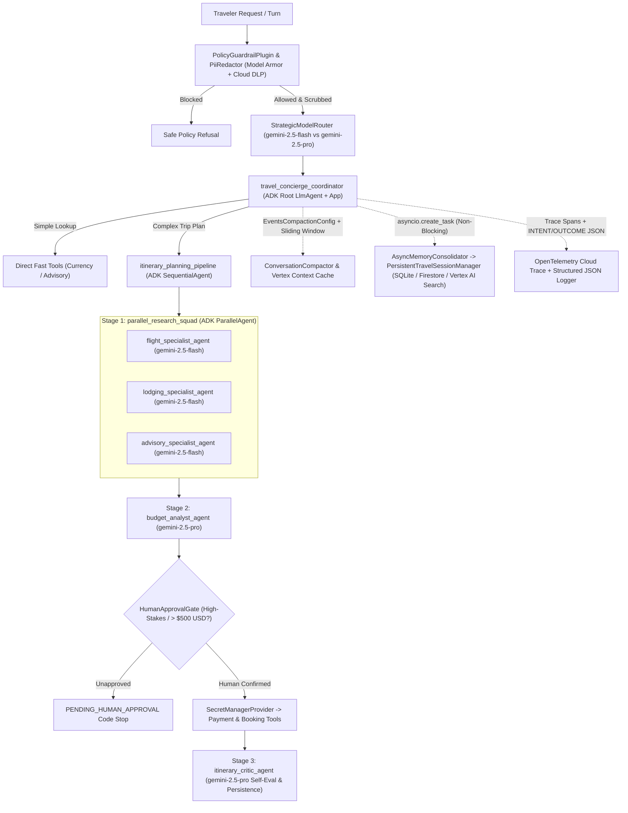

# Personal Travel & Budget Concierge Agent

Production-grade multi-agent reference implementation built with the **Google Agent Development Kit (`google-adk`)**, **Vertex AI Gemini 2.5**, **OpenTelemetry**, **Google Cloud Secret Manager**, **Sensitive Data Protection (Cloud DLP)**, and **Terraform**.

---

## 1. Problem Statement & Solution Overview

Planning multi-destination travel under strict financial constraints requires coordinating heterogeneous domain tasks—commercial flight search, verified lodging comparison, destination safety advisories, foreign exchange conversion, budget trade-off optimization, and payment execution—while protecting sensitive traveler PII and preventing unauthorized financial commitments.

**Personal Travel & Budget Concierge Agent** solves this with a defense-in-depth **AgentOps** architecture:

- **Hierarchical & Parallel Multi-Agent Orchestration**: A root ADK `LlmAgent` coordinator delegates complex trip planning to a `SequentialAgent` pipeline (`itinerary_planning_pipeline`) that fans out flight, lodging, and safety research concurrently via a `ParallelAgent` (`parallel_research_squad`), synthesizes financial trade-offs in `budget_analyst_agent`, and verifies constraint satisfaction in `itinerary_critic_agent`.
- **Cost- & Latency-Aware Strategic Model Routing**: Routine single-step lookups (currency conversion, travel advisories, FAQs) dynamically route to **`gemini-2.5-flash`**, while multi-city itinerary synthesis, group constraint resolution, and budget optimization route to **`gemini-2.5-pro`**.
- **Deterministic Financial & Safety Guardrails**: Input screening (`PolicyGuardrailPlugin` + Google Cloud Model Armor integration) blocks prompt-injection and credential-exfiltration attempts; a deterministic **Human-in-the-Loop (`HumanApprovalGate`)** halts high-value payments (`> $500 USD`), lodging reservations, and flight holds until explicit human confirmation is recorded; an output self-critic prevents silent budget overruns.
- **Compacted Context & Non-Blocking Persistent Memory**: Sliding-window token compaction (`ConversationCompactor` + ADK `EventsCompactionConfig` + Vertex AI Context Caching) prevents context bloat while preserving traveler constraints. Session turns and vector-indexed traveler preferences persist across restarts (SQLite locally, Firestore + Vertex AI Search in production) with non-blocking `asyncio.create_task` memory consolidation (`AsyncMemoryConsolidator`).
- **Full-Fidelity Observability & Privacy**: Every agent and tool boundary emits single-line Cloud-Logging-compatible JSON logs, pairs pre-execution `INTENT` records with post-execution `OUTCOME` records via `correlation_id`, propagates OpenTelemetry parent/child trace spans (`CloudTraceSpanExporter`), and scrubs PII (`[REDACTED_EMAIL]`, `[REDACTED_PHONE]`, `[REDACTED_CARD]`, `[REDACTED_PASSPORT]`, `[REDACTED_SSN]`, `[REDACTED_SECRET]`) before log emission or memory persistence.

---

## 2. System Architecture



---

## 3. 95-Point AgentOps Grading Rubric — Code Evidence Matrix

| ID | Category & Criterion | Pts | Implementation Evidence (File Paths, Classes & Functions) |
| :--- | :--- | :---: | :--- |
| **1.1** | **Comprehensive Tool Docstrings** | 5 | `travel_concierge/tools/flight_tools.py`, `lodging_tools.py`, `budget_tools.py`, `itinerary_tools.py` — Every tool documents summary, typed argument constraints, return JSON schema, and LLM error-recovery instructions. |
| **1.2** | **Descriptive Naming** | 5 | `travel_concierge/tools/__init__.py` — Specific verb-noun names: `search_commercial_flights`, `hold_refundable_flight_reservation`, `search_verified_accommodations`, `reserve_lodging_booking`, `calculate_trip_budget_allocation`, `convert_currency_exchange_rate`, `authorize_high_value_travel_payment`, `retrieve_destination_travel_advisories`, `persist_finalized_trip_itinerary`. |
| **1.3** | **Explicit JSON Schemas** | 5 | `travel_concierge/schemas.py` — Strict Pydantic / Draft 2020-12 models (`FlightSearchInput`/`Output`, `AccommodationSearchInput`/`Output`, `BudgetAllocationInput`/`Output`, `PaymentAuthorizationInput`/`Output`, `ToolErrorOutput`, etc.) enforcing `additionalProperties: false`, ISO dates, IATA/currency codes, and numeric bounds. |
| **1.4** | **Guided Error Handling** | 5 | `travel_concierge/schemas.py` (`ToolErrorOutput`) & `travel_concierge/tools/*.py` — Invalid parameters or missing secrets never crash; tools return structured `status="error"` payloads with actionable `recovery_instructions` so the LLM can self-correct. |
| **2.1** | **Robust System Instructions** | 5 | `travel_concierge/prompts.py` — `AGENT_CONSTITUTION` defines Persona & Mission, Domain Expertise, Financial & Budget Integrity Rules, Safety/Privacy/PII Constraints, Mandatory HITL Escalation Rules, and Tool Error Recovery Protocol, paired with specialist prompts. |
| **2.2** | **History Compaction** | 5 | `travel_concierge/memory/compaction.py` — `build_adk_compaction_config()` (`EventsCompactionConfig`), `build_context_cache_config()` (Vertex AI Context Caching), and `ConversationCompactor` (token estimation, sliding window retention, and `[COMPACTED_CONVERSATION_SUMMARY]` extraction). |
| **2.3** | **Persistent Session State** | 5 | `travel_concierge/memory/session_store.py` — `PersistentTravelSessionManager` persists multi-turn history, session state, and cosine-indexed semantic memories in durable SQLite with managed Cloud Firestore & Vertex AI Search adapters and `create_adk_session_service()`. |
| **2.4** | **Async Memory Operations** | 5 | `travel_concierge/memory/async_memory.py` — `AsyncMemoryConsolidator.schedule_consolidation()` dispatches background fact extraction and PII-scrubbed vector storage via `asyncio.create_task` + ADK `after_agent_memory_callback`. |
| **3.1** | **Multi-Agent Patterns** | 5 | `travel_concierge/agents/sub_agents.py` & `coordinator.py` — Root `travel_concierge_coordinator` (`LlmAgent`), `parallel_research_squad` (`ParallelAgent` over flight, lodging, and advisory specialists), and `itinerary_planning_pipeline` (`SequentialAgent` chaining research -> budget analyst -> critic). |
| **3.2** | **Strategic Model Routing** | 5 | `travel_concierge/agents/model_router.py` — `StrategicModelRouter` & `dynamic_model_routing_callback` route low-complexity lookups to `gemini-2.5-flash` and complex multi-city/budget trade-off reasoning to `gemini-2.5-pro`. |
| **3.3** | **Guardrails & Policy Plugins** | 5 | `travel_concierge/guardrails/policy_plugin.py` — `PolicyGuardrailPlugin` (ADK `BasePlugin`) implements `before_model_callback` / `after_model_callback`, prompt-injection blocking, Google Cloud Model Armor hook, and output budget-compliance critic. |
| **3.4** | **Human-in-the-Loop Hooks** | 5 | `travel_concierge/guardrails/hitl_hooks.py` — `HumanApprovalGate` & `hitl_before_tool_callback` enforce a deterministic `PENDING_HUMAN_APPROVAL` code stop and ADK `ToolContext.request_confirmation` before high-value payments or bookings execute. |
| **4.1** | **Structured JSON Logging** | 5 | `travel_concierge/observability/logging_config.py` — `python-json-logger` + Cloud Logging JSON formatter emitting structured `severity`, `event_type`, `logging.googleapis.com/trace`, `logging.googleapis.com/spanId`, and `metadata` (zero `print()` statements in `travel_concierge/`). |
| **4.2** | **Intent vs. Outcome Capture** | 5 | `travel_concierge/observability/intent_outcome.py` — `IntentOutcomeTracker` & `IntentOutcomePlugin` emit paired pre-execution `INTENT` and post-execution `OUTCOME` records linked via `correlation_id`. |
| **4.3** | **Distributed Tracing** | 5 | `travel_concierge/observability/tracing.py` — OpenTelemetry `TracerProvider`, `BatchSpanProcessor`, `CloudTraceSpanExporter`, and `contextvars`-propagated `trace_operation` linking user query -> coordinator -> sub-agent -> tool spans. |
| **4.4** | **PII Redaction** | 5 | `travel_concierge/observability/pii_redactor.py` — `PiiRedactor` combines Google Cloud DLP (`deidentify_content`) with deterministic regex & key-based scrubbing across both logging (`logging.Filter`) and memory consolidation pipelines. |
| **5.1** | **Automated Evaluation Suites** | 5 | `evals/golden_dataset.evalset.json`, `evals/test_config.json`, `evals/run_evals.py`, `.github/workflows/ci-eval.yml` — ADK `EvalSet` golden scenarios + deterministic & `--adk-live` regression gate executed automatically on every PR/push. |
| **5.2** | **Infrastructure as Code** | 5 | `terraform/versions.tf`, `variables.tf`, `main.tf`, `outputs.tf`, `Dockerfile` — Declarative Terraform provisioning GCP APIs, least-privilege IAM SA, Secret Manager, Firestore Native, Vertex AI Search, Cloud DLP templates, and Cloud Run v2. |
| **5.3** | **Secure Secret Management** | 5 | `travel_concierge/config.py` (`SecretManagerProvider`) & `terraform/main.tf` — Runtime retrieval via `SecretManagerServiceClient.access_secret_version` with TTL cache and Cloud Run `secret_key_ref` injection; zero hardcoded secrets. |

---

## 4. Repository Layout

```text
travel-concierge-agent/
├── .env.example                       # Sanitized environment configuration template
├── .gitignore                         # Excludes .env, credentials, .tfstate, caches
├── Dockerfile                         # Non-root production container running ADK API server
├── Makefile                           # Developer shortcuts for lint, test, eval, terraform
├── pyproject.toml                     # PEP 621 package metadata, ruff & pytest config
├── requirements.txt                   # Runtime & evaluation dependencies
├── README.md                          # Architecture, rubric matrix & deployment guide
├── .github/workflows/
│   └── ci-eval.yml                    # CI pipeline: secret scan, ruff, pytest, evals, terraform
├── evals/
│   ├── golden_dataset.evalset.json    # ADK EvalSet covering 8+ golden scenarios
│   ├── test_config.json               # Trajectory (0.9) & response (0.8) score thresholds
│   └── run_evals.py                   # Offline deterministic & --adk-live regression runner
├── terraform/
│   ├── versions.tf                    # Terraform >= 1.5 & hashicorp/google >= 5.0
│   ├── variables.tf                   # Parameterized project, region, models, scaling
│   ├── main.tf                        # APIs, IAM SA, Secret Manager, Firestore, Search, DLP, Cloud Run v2
│   └── outputs.tf                     # Exported service URI, SA email, store & DLP template IDs
├── travel_concierge/
│   ├── __init__.py                    # Exports root_agent, app, TravelConciergeOrchestrator
│   ├── agent.py                       # ADK CLI entrypoint (root_agent & app)
│   ├── config.py                      # TravelConciergeConfig & SecretManagerProvider
│   ├── prompts.py                     # AGENT_CONSTITUTION & specialist system instructions
│   ├── schemas.py                     # Strict Draft 2020-12 input/output JSON schemas
│   ├── tools/                         # Flight, lodging, budget, currency, payment & itinerary tools
│   ├── memory/                        # Compaction, persistent SQLite/Firestore sessions, async memory
│   ├── guardrails/                    # PolicyGuardrailPlugin (Model Armor) & HumanApprovalGate (HITL)
│   ├── agents/                        # StrategicModelRouter, Parallel/Sequential sub-agents, Coordinator
│   └── observability/                 # PiiRedactor, JSON logging, OpenTelemetry tracing, Intent/Outcome
└── tests/
    ├── test_tools_and_schemas.py      # Cat 1 + Cat 5.3 unit tests
    ├── test_memory_and_context.py     # Cat 2 unit tests
    ├── test_orchestration.py          # Cat 3 unit tests
    ├── test_observability.py          # Cat 4 unit tests
    └── test_eval_harness.py           # Cat 5.1 regression harness tests
```

---

## 5. Local Development, Testing & Evaluation

### 5.1 Environment Setup

```bash
python3 -m venv .venv
source .venv/bin/activate
pip install --upgrade pip
pip install -e ".[dev]"

cp .env.example .env
# Update GOOGLE_CLOUD_PROJECT=your-gcp-project-id in .env for live Vertex AI calls
```

### 5.2 Run Unit Tests & Linter

The test suite uses standard-library `unittest` (`TestCase` and `IsolatedAsyncioTestCase`) and is 100% compatible with both `pytest` and bare Python `unittest` discovery:

```bash
# Run via pytest
pytest -v

# Or run via standard library unittest discovery (zero external test runner required)
PYTHONPATH=. python3 -m unittest discover -s tests -v

# Lint with Ruff
ruff check travel_concierge tests evals
```

### 5.3 Run the Golden Dataset Evaluation Suite

```bash
# 1. Deterministic offline regression gate (fast, zero cloud cost, runs in CI on every PR)
PYTHONPATH=. python3 evals/run_evals.py \
  --dataset evals/golden_dataset.evalset.json \
  --config evals/test_config.json

# 2. Live Vertex AI ADK AgentEvaluator run (requires authenticated GCP project)
PYTHONPATH=. python3 evals/run_evals.py --adk-live

# 3. Direct ADK CLI evaluation command
adk eval travel_concierge evals/golden_dataset.evalset.json \
  --config_file_path=evals/test_config.json
```

---

## 6. ADK CLI & Agent Starter Pack Commands

### Interactive Local Execution

```bash
# Launch the interactive ADK Dev UI (inspect events, tool calls, state, and trace spans)
adk web .

# Run an interactive CLI session against the travel_concierge package
adk run travel_concierge
```

### Managed Deployment & Agent Starter Pack

```bash
# Enhance / scaffold production AgentOps templates with Google Cloud Agent Starter Pack
uvx agent-starter-pack enhance

# Deploy to Vertex AI Agent Engine (managed session, memory bank, and autoscaling runtime)
adk deploy agent_engine \
  --project="${GOOGLE_CLOUD_PROJECT}" \
  --region="${GOOGLE_CLOUD_LOCATION:-us-central1}" \
  --staging_bucket="gs://${GOOGLE_CLOUD_PROJECT}-adk-staging" \
  travel_concierge

# Or deploy directly to Google Cloud Run via ADK CLI
adk deploy cloud_run \
  --project="${GOOGLE_CLOUD_PROJECT}" \
  --region="${GOOGLE_CLOUD_LOCATION:-us-central1}" \
  --service_name="travel-concierge-agent" \
  --with_ui \
  travel_concierge
```

---

## 7. Production Deployment with Terraform (IaC)

All cloud infrastructure is declaratively managed under [`terraform/`](terraform/):

1. **Build and push the container image to Artifact Registry**:
   ```bash
   gcloud builds submit --tag "us-central1-docker.pkg.dev/${GOOGLE_CLOUD_PROJECT}/agents/travel-concierge-agent:v1.0.0" .
   ```

2. **Initialize, validate, and apply Terraform**:
   ```bash
   cd terraform
   terraform init
   terraform fmt -check
   terraform validate

   terraform apply \
     -var="project_id=${GOOGLE_CLOUD_PROJECT}" \
     -var="region=us-central1" \
     -var="container_image=us-central1-docker.pkg.dev/${GOOGLE_CLOUD_PROJECT}/agents/travel-concierge-agent:v1.0.0"
   ```

3. **Populate the payment gateway secret version in Secret Manager** (never stored in Git or `.tfstate` plaintext inputs):
   ```bash
   printf "%s" "${LIVE_PAYMENT_GATEWAY_SECRET}" | \
     gcloud secrets versions add travel-payment-gateway-token --data-file=-
   ```

---

## 8. Security, Privacy & Governance Posture

- **Zero Hardcoded Secrets**: Payment credentials are fetched exclusively at runtime through `SecretManagerProvider` (`google-cloud-secret-manager`) or Cloud Run `secret_key_ref` volume/env bindings.
- **Defense-in-Depth PII Scrubbing**: `PiiRedactor` scrubs emails, phone numbers, credit card numbers, passport IDs, SSNs, and bearer tokens before any record enters Cloud Logging or persistent session/vector memory.
- **Mandatory Human-in-the-Loop**: `HumanApprovalGate` enforces a hard programmatic stop (`PENDING_HUMAN_APPROVAL`) before executing `authorize_high_value_travel_payment`, `reserve_lodging_booking`, `hold_refundable_flight_reservation`, or any non-refundable / `> $500 USD` transaction.
